<p align="center"></p>

# Toll x402 examples

Sell or buy an API for USDG on Robinhood Chain with [x402](https://x402.org). Toll's facilitator verifies and settles every payment.

- Facilitator: `https://x402.t0ll.xyz` (no API key, no fee, it pays the gas)
- Network: `eip155:4663` (Robinhood Chain)
- Asset: USDG, `0x5fc5360D0400a0Fd4f2af552ADD042D716F1d168`, 6 decimals
- Docs: [x402.t0ll.xyz/docs](https://x402.t0ll.xyz/docs) · spec for agents: [t0ll.xyz/llms.txt](https://t0ll.xyz/llms.txt)

## Quick start

```sh
cp .env.example .env              # set PAY_TO (seller) and PAYER_KEY (a throwaway buyer wallet)
cd seller/express && npm i && npm start
# in a second terminal:
cd buyer && npm i
npm run exact                     # dry run: reads the 402, signs, asks /verify. Nothing moves.
SETTLE=1 npm run exact            # pays 0.01 USDG and prints the answer
```

## Examples

| Example | What it shows | Run |
| --- | --- | --- |
| [seller/express](seller/express) | One paid route with the official `@x402/express` middleware | `npm start` |
| [seller/hono](seller/hono) | The same with `@x402/hono` | `npm start` |
| [seller/next](seller/next) | A Next.js route handler with `withX402` from `@x402/next` | `npm run dev` |
| [buyer/pay-exact.ts](buyer/pay-exact.ts) | Pay any x402 URL with the official `@x402/fetch` client (EIP-3009) | `npm run exact` |
| [buyer/pay-permit2.ts](buyer/pay-permit2.ts) | Exact through Permit2 (`extra.assetTransferMethod: "permit2"`) | `npm run permit2 -- 0.01` |
| [buyer/pay-upto.ts](buyer/pay-upto.ts) | Upto: sign a maximum, the seller settles what it used | `npm run upto -- 0.01 0.004` |
| [buyer/set-budget.ts](buyer/set-budget.ts) | Per-payer spending budget: sign, set, read back, revoke | `npm run budget -- set` |
| [buyer/escrow.ts](buyer/escrow.ts) | Escrow with refunds (auth-capture): hold, capture, refund, void | `npm run escrow -- 0.01 0.006` |
| [buyer/batch.ts](buyer/batch.ts) | Sub-cent payments (batch-settlement): one deposit, many vouchers | `npm run batch -- 0.01 0.001 3` |
| [buyer/supported.ts](buyer/supported.ts) | What the facilitator settles right now | `npm run supported` |

## Safety first

- **Use a throwaway wallet with a few cents.** Never put a wallet you care about in `PAYER_KEY` or `SELLER_KEY`.
- Keys come from `.env` only. `.env` is git-ignored. Never commit it.
- Nothing moves until you set `SETTLE=1`. Without it, every buyer script signs and calls `/verify` only.
- `MAX_USDG` caps one payment (default 0.05 USDG). The scripts refuse anything above it.
- Permit2 and upto approve Permit2 for exactly the amount, never unlimited. That approve is one transaction, so the payer needs a little ETH for gas.
- A revoked budget refuses every payment from that payer until you set a new one.

## Selling

Each seller example answers `GET /weather` with a 402 until it is paid 0.01 USDG.
The 402 carries this requirement:

```json
{
  "scheme": "exact",
  "network": "eip155:4663",
  "amount": "10000",
  "asset": "0x5fc5360D0400a0Fd4f2af552ADD042D716F1d168",
  "payTo": "<PAY_TO>",
  "maxTimeoutSeconds": 300,
  "extra": { "name": "Global Dollar", "version": "1" }
}
```

- `PAY_TO` is the wallet that gets paid.
- Set `AGENT_ID` to your ERC-8004 agent id on Robinhood Chain and the requirement also carries `extra.erc8004`. The facilitator then checks that `PAY_TO` is that agent's wallet (ERC-8478) and refuses a mismatch.
- Next.js reads env from its own folder: put `PAY_TO` in `seller/next/.env.local`.

**About `usdg.ts`.** `@x402/evm` 2.30.0 (the latest on npm today) has no default asset for `eip155:4663`, so `price: "$0.01"` needs a small money parser. USDG was added upstream as the default asset for Robinhood Chain ([x402-foundation/x402#4207](https://github.com/x402-foundation/x402/pull/4207), merged 2026-11-10). Once the next `@x402/evm` release is out, `new ExactEvmScheme()` works on its own and the parser can go. The buyer scripts allow USDG by address in `setSpendControls` for the same reason.

Prefer zero dependencies? [`@tollxyz/x402-seller`](https://www.npmjs.com/package/@tollxyz/x402-seller) puts a USDG price on any Web-standard handler in one line: `paywall({ payTo, price: "0.01" }, handler)`.

## Buying

- `pay-exact.ts` pays a real 402. Point `TARGET_URL` at any x402 seller that takes USDG on Robinhood Chain. For example `https://t0ll.xyz/api/x402/pulse` (0.01 USDG). Paid APIs on Robinhood Chain are listed at [x402.t0ll.xyz/discovery/resources](https://x402.t0ll.xyz/discovery/resources).
- `pay-permit2.ts`, `pay-upto.ts`, `escrow.ts` and `batch.ts` play both sides. They build the seller's requirement, sign as the payer and call the facilitator's `/verify` and `/settle` directly. They pay `PAY_TO_FOR_BUYER`.
- `escrow.ts` also needs `SELLER_KEY`: the seller signs capture, refund and void.
- In `batch.ts` the facilitator claims later, in one transaction for many channels. After the claim, `SETTLE=1 npm run batch -- refund` (with `SELLER_KEY`) gives the payer back the rest. Or the payer withdraws it on the contract after a 1-day delay.

## Facilitator endpoints

| Endpoint | What |
| --- | --- |
| `POST /verify`, `POST /settle` | The x402 body (v1 or v2) |
| `GET /supported` | Schemes, assets, contracts and signers |
| `POST /budget`, `GET /budget?payer=` | A payer's spending budget |
| `GET /receipt/<id or tx>` | One settlement and its signed receipt |
| `GET /paid?payer=&payTo=` | Whether a wallet already paid this payTo here |
| `GET /stats` | Live numbers |
| `GET /discovery/resources` | Paid APIs on Robinhood Chain |

Limits: 0.001 to 100 USDG a payment. Payers must be plain wallets (EOA). Full details: [x402.t0ll.xyz/docs](https://x402.t0ll.xyz/docs).

## Versions

Built and type-checked with `@x402/core`, `@x402/evm`, `@x402/express`, `@x402/hono`, `@x402/next` and `@x402/fetch` 2.30.0, `viem` 2.57, `express` 5.3, `hono` 4.13, `next` 16.4 and TypeScript 7. Node 22.9 or newer (the npm scripts use `--env-file-if-exists`).

## License

MIT
